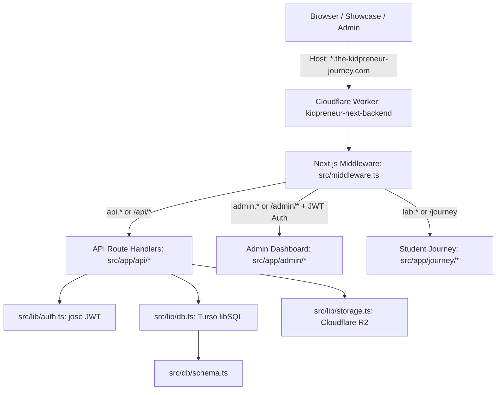

# Next.js Backend & Learning Lab — Code Documentation

> **The Kidpreneur Journey — Full-Stack Application, CMS & Learning Platform**  
> Built with **Next.js 16.2.11 (App Router)**, **React 19.2**, **TypeScript 5 (Strict)**, **Drizzle ORM 0.45**, and **Turso (libSQL)**.  
> Production deployment: Hosted on **Cloudflare Workers** via `@opennextjs/cloudflare` as worker service `kidpreneur-next-backend`.

---

## 1. System Architecture & Operating Principles

The `next-app` serves three distinct functions within the Kidpreneur ecosystem:
1. **REST API Engine**: Provides 18+ secure endpoints handling authentication, student session progress, activity autosaving, contact messages, media storage, and portfolio CRUD.
2. **Admin CMS Portal (`/admin/*`)**: Complete content management system for managing enrolled learners, unlocking curriculum sessions, publishing workshops, managing R2 media, and reviewing inquiries.
3. **Student Learning Lab (`/journey`, `/register/lab`)**: An interactive 10-session entrepreneurship journey featuring dynamic worksheets, financial calculators, pitch timers, and unlockable session milestones.



### Invariant Rules
- **Database**: Strictly **Drizzle ORM** with `@libsql/client/web` connecting to Turso SQLite. (Prisma is legacy and must never be used).
- **Authentication**: Stateless HS256 JWT tokens signed with `jose`. `admin_token` cookie controls access to `/admin/*`; `auth_token` cookie controls student/parent sessions.
- **Routing**: Subdomain-aware via `middleware.ts` (`api.` rewrites to `/api`, `admin.` rewrites to `/admin`).
- **Media**: Uploaded to Cloudflare R2 bucket (`kidpreneur-media`) via `MEDIA_BUCKET` binding, with an automatic base64 fallback for local development.

---

## 2. Directory Structure & File Map

```
next-app/
├── src/
│   ├── app/                    # Next.js App Router (Pages & REST Endpoints)
│   │   ├── admin/              # Admin CMS Dashboard Pages & Server Actions
│   │   ├── api/                # 18+ REST API Route Handlers
│   │   ├── journey/            # Interactive Student Lab Platform
│   │   ├── login/              # Student & Parent Login Page
│   │   ├── register/lab/       # Public Lab Registration Flow
│   │   ├── globals.css         # App Router CSS tokens & animations
│   │   ├── layout.tsx          # Root HTML layout with font injections
│   │   └── page.tsx            # Root landing / redirector
│   ├── components/             # Reusable UI & Domain Components
│   │   ├── activities/         # Interactive student learning tools (6 tools)
│   │   ├── admin/              # Admin CMS tables, editors, and modal dialogs
│   │   ├── common/             # Progress rings, session cards, toast notifications
│   │   ├── forms/              # Registration and contact forms
│   │   ├── layout/             # Header and footer layouts
│   │   ├── ui/                 # Shadcn / Radix primitives
│   │   └── views/              # View switchers for the 10 Journey tabs
│   ├── context/                # React Contexts (AuthContext, JourneyContext)
│   ├── data/                   # Static definitions for 10 curriculum sessions
│   ├── db/                     # Drizzle ORM schema and database migrations
│   ├── hooks/                  # Custom React hooks (useActivityForm, useAdminConfirm)
│   ├── lib/                    # Core utilities (auth, db, storage, utils)
│   ├── services/               # Storage and data services
│   ├── types/                  # Global TypeScript interfaces
│   ├── middleware.ts           # Subdomain routing, CORS & JWT security gate
│   ├── App.tsx                 # Legacy client shell fallback
│   ├── index.css               # Base CSS stylesheet
│   └── main.tsx                # Client entrypoint fallback
├── drizzle/                    # Generated SQL migrations
├── public/                     # Static files, brand logos, favicons
├── drizzle.config.ts           # Drizzle Kit migration & push configuration
├── next.config.ts              # Next.js build & compiler settings
├── open-next.config.ts         # OpenNext Cloudflare Workers bundling profile
├── package.json                # Dependencies and npm build/deploy scripts
├── tsconfig.json               # TypeScript strict configuration
└── wrangler.jsonc              # Cloudflare Worker deployment specification & R2 bindings
```

---

## 3. Exhaustive File-by-File Guide

### A. Root Infrastructure & Configuration

#### `src/middleware.ts`
- **Purpose**: Subdomain router, security firewall, and CORS interceptor.
- **Detailed Mechanics**:
  1. **Subdomain Rewriting**:
     - Requests with `Host: api.*` are rewritten to `/api/*`.
     - Requests with `Host: admin.*` are rewritten to `/admin/*`.
  2. **Online Lab Interception**:
     - Temporarily intercepts non-API and non-admin routes in production and issues a `307 Temporary Redirect` to `https://the-kidpreneur-journey.com`, taking down the student-facing Lab online while keeping the backend API and Admin CMS 100% active.
  3. **CORS Handling**:
     - Intercepts `OPTIONS` preflight requests on `/api/*` and sets `Access-Control-Allow-Origin`, `Access-Control-Allow-Credentials: true`, and permitted methods/headers.
  4. **Admin Protection**:
     - Protects all `/admin/*` routes (except `/admin/login`).
     - Reads the `admin_token` cookie, verifies the JWT using `jose`, and verifies `payload.role === 'ADMIN'`. Invalid or missing tokens trigger an immediate redirect to `/admin/login`.
     - Redirects already-authenticated admins attempting to visit `/admin/login` directly to `/admin`.

#### `wrangler.jsonc`
- **Purpose**: Cloudflare Workers deployment configuration.
- **Configures**:
  - Worker name: `kidpreneur-next-backend`.
  - Main entry: `.open-next/worker.js`.
  - Compatibility date: `2024-09-23` with flag `nodejs_compat`.
  - Assets binding: `env.ASSETS` pointing to `.open-next/assets`.
  - R2 Bucket binding: `env.MEDIA_BUCKET` pointing to bucket `kidpreneur-media`.

#### `drizzle.config.ts`
- **Purpose**: Configures Drizzle Kit for schema migrations and live database syncing.
- **Points To**: Schema file `src/db/schema.ts`, dialect `turso`, output `drizzle/`, using environment credentials `TURSO_DATABASE_URL` and `TURSO_AUTH_TOKEN`.

#### `next.config.ts`
- **Purpose**: Next.js 16 compiler and asset configuration. Configures image domains, experimental settings, and package optimizations.

---

### B. Database Layer (`src/db/` & `src/lib/db.ts`)

#### `src/lib/db.ts`
- **Purpose**: Singleton database client initialization.
- **Implementation**: Instantiates `@libsql/client/web` using `process.env.TURSO_DATABASE_URL` and `process.env.TURSO_AUTH_TOKEN`, and wraps it with `drizzle-orm/libsql`.

#### `src/db/schema.ts`
- **Purpose**: Definitive Drizzle ORM schema specification for all 10 database tables:
  1. `users`: Core account table (`id`, `email`, `passwordHash`, `fullName`, `role` ['STUDENT', 'PARENT', 'ADMIN'], `avatarUrl`, timestamps).
  2. `course_sessions`: 10 structured curriculum sessions (`sessionNumber`, `title`, `description`, `secretCode`, `status`, `orderIndex`).
  3. `user_progress`: Student progression records per session (`id`, `userId`, `sessionNumber`, `status` ['Locked', 'In Progress', 'Completed'], `notes`, `reflection`, `unlockedAt`, `completedAt`).
  4. `activity_submissions`: Detailed student activity form submissions (`id`, `userId`, `activitySlug`, `sessionNumber`, `formData` [JSON string], `score`, `status`, `feedback`).
  5. `activity_states`: Autosaved draft states per student workspace (`id`, `userId`, `activityId`, `stateJson`, `updatedAt`).
  6. `global_learner_states`: Cross-session learner variables like selected business idea, brand name, and target audience (`id`, `userId`, `stateJson`, `updatedAt`).
  7. `contact_messages`: Public inquiries submitted via the contact form (`id`, `name`, `email`, `phone`, `interest`, `message`, `isRead`, `createdAt`).
  8. `portfolio_items`: Published workshops, activities, and Instagram posts (`id`, `title`, `slug`, `type` ['WORKSHOP', 'ACTIVITY', 'INSTAGRAM'], `status` ['UPCOMING', 'COMPLETED'], `category`, `eventDate`, `eventTime`, `location`, `summary`, `content`, `coverImageUrl`, `galleryImages`, `instagramUrl`, `ctaText`, `ctaUrl`, `isFeatured`, `isPublished`, `orderIndex`, timestamps).
  9. `media_assets`: Metadata for assets uploaded to Cloudflare R2 (`id`, `filename`, `storageKey`, `mimeType`, `sizeBytes`, `url`, `uploadedBy`, `createdAt`).
  10. `lab_registrations`: Parent signups from the public registration flow (`id`, `parentFullName`, `parentPhone`, `parentEmail`, `childFullName`, `childAge`, `status` ['PENDING', 'CONFIRMED', 'CANCELLED'], `createdUserId`, timestamps).

---

### C. Core Libraries & Utilities (`src/lib/` & `src/services/`)

#### `src/lib/auth.ts`
- **Purpose**: Stateless JWT token creation, verification, and cookie handling.
- **Key Functions**:
  - `signJwtToken(payload, expiresIn)`: Signs payload with HS256 using `process.env.JWT_SECRET`.
  - `verifyJwtToken(token)`: Validates signature and expiration using `jose.jwtVerify`.
  - `getAuthSession(request)`: Helper to extract and verify the `auth_token` cookie.
  - `getAdminSession(request)`: Helper to extract and verify the `admin_token` cookie.

#### `src/lib/storage.ts`
- **Purpose**: Cloudflare R2 file storage client with local base64 fallback.
- **Key Functions**:
  - `uploadFileToStorage(file, folder)`: Uploads buffer to R2 bucket via Worker binding `env.MEDIA_BUCKET`. If running locally without R2 credentials, generates a data URL fallback so development never fails.
  - `deleteFileFromStorage(storageKey)`: Deletes object from Cloudflare R2 bucket.

#### `src/services/storageService.ts`
- **Purpose**: High-level wrapper managing asset metadata insertion and deletion in tandem with `src/lib/storage.ts`.

#### `src/lib/utils.ts`
- **Purpose**: Standard Shadcn UI utility combining `clsx` and `tailwind-merge` for reliable CSS class composition.

---

### D. REST API Endpoints (`src/app/api/`)

#### 1. Authentication Endpoints
- **`src/app/api/auth/login/route.ts`**: Validates email/password credentials via `bcryptjs`, issues signed `auth_token` cookie with 7-day expiration, and returns the sanitized user object.
- **`src/app/api/auth/logout/route.ts`**: Clears `auth_token` cookie.
- **`src/app/api/auth/me/route.ts`**: Inspects `auth_token` cookie and returns current logged-in user profile. Returns 401 if unauthenticated.
- **`src/app/api/auth/register/route.ts`**: Registers a new user account with hashed password and role assignment (`STUDENT` or `PARENT`).

#### 2. Admin Authentication Endpoints
- **`src/app/api/admin/auth/login/route.ts`**: Dedicated admin gate. Validates credentials and strictly verifies `user.role === 'ADMIN'`. Issues 1-day HTTP-only `admin_token` cookie.
- **`src/app/api/admin/auth/logout/route.ts`**: Clears `admin_token` cookie.

#### 3. Public Portfolio Endpoints (Consumed by Vite Showcase)
- **`src/app/api/portfolio/route.ts`**: Returns published workshops, activities, and Instagram posts. Features dynamic date calculation: automatically marks upcoming workshops as `COMPLETED` if their event date has elapsed.
- **`src/app/api/portfolio/[slug]/route.ts`**: Fetches full detail for a single workshop by slug.
- **`src/app/api/portfolio/activities/route.ts`**: Returns active curriculum activity links for navigation.

#### 4. Admin Content & Media Management Endpoints
- **`src/app/api/admin/portfolio/route.ts`**: `GET` returns all items (including drafts and unpublished); `POST` creates a new workshop or Instagram card.
- **`src/app/api/admin/portfolio/[id]/route.ts`**: `PUT` updates existing item; `DELETE` removes item.
- **`src/app/api/admin/media/route.ts`**: `GET` lists all uploaded assets; `POST` accepts `multipart/form-data` file upload and stores to R2.
- **`src/app/api/admin/media/[id]/route.ts`**: `DELETE` removes media asset from R2 and database.
- **`src/app/api/admin/instagram/fetch/route.ts`**: Fetches recent media from the Instagram Graph API and generates draft portfolio records.
- **`src/app/api/media/[...key]/route.ts`**: Streaming proxy endpoint serving files directly from Cloudflare R2 bucket.

#### 5. Learner Registration & Admin Verification
- **`src/app/api/register/lab/route.ts`**: Public intake endpoint for parents registering children. Inserts pending record into `lab_registrations`.
- **`src/app/api/admin/learners/lab/route.ts`**: Admin endpoint listing all lab registration inquiries with filtering.
- **`src/app/api/admin/learners/confirm/route.ts`**: Converts a pending registration into an active student account, generating login credentials and marking status as `CONFIRMED`.

#### 6. Student Progress & Interactive Workspaces
- **`src/app/api/progress/route.ts`**: `GET` returns student session completion list; `POST` saves session notes, reflections, and sets completion status.
- **`src/app/api/progress/unlock/route.ts`**: Validates secret session code (e.g. `SPARK3`) and enforces sequential progression (ensuring Session $N-1$ is completed before Session $N$ can unlock).
- **`src/app/api/activities/autosave/route.ts`**: High-frequency endpoint persisting learner workspace inputs and updating cross-activity global state.
- **`src/app/api/activities/resume/route.ts`**: Retrieves autosaved draft state and merged global variables for a student loading an activity.

#### 7. General Inquiries
- **`src/app/api/contact/route.ts`**: Receives public contact form submissions and writes to `contact_messages`.

---

### E. App Router Pages & Layouts (`src/app/`)

#### `src/app/layout.tsx`
- Root App Router layout. Injects Google fonts (`Fredoka` and `Nunito`) and sets up root metadata.

#### `src/app/page.tsx`
- Landing page handler. Redirects to `/journey` or showcase.

#### `src/app/login/page.tsx`
- Student and parent login interface with interactive form validation.

#### `src/app/register/lab/page.tsx`
- Multi-step parent registration form for enrolling a child into The Kidpreneur Lab. Features live validation and clean production back-navigation to `https://the-kidpreneur-journey.com`.

#### `src/app/journey/page.tsx` & `JourneyClient.tsx`
- The flagship Student Learning Lab application. Hosts the interactive 10-session roadmap, top navigation tab bar, and dynamically loads interactive activity modules.

---

### F. Admin CMS Pages & Actions (`src/app/admin/`)

#### `src/app/admin/layout.tsx` & `AdminLayoutClient.tsx`
- Persistent admin dashboard shell with collapsible navigation sidebar (`AdminSidebar.tsx`), header user badge, and logout trigger.

#### `src/app/admin/page.tsx` & `AdminDashboardClient.tsx`
- Main analytics overview displaying enrolled learners, active sessions, inquiries count, and quick management links.

#### `src/app/admin/login/page.tsx`
- Clean, focused admin login page with password reveal and rate-limiting alerts.

#### `src/app/admin/sessions/page.tsx` & `SessionsPageClient.tsx`
- Comprehensive 10-session curriculum manager. Allows editing session titles, secret unlock codes, lesson plans, and status.

#### `src/app/admin/learners/page.tsx`
- Enrolled student management table displaying completion progress, unlock statuses, and student detail profiles.

#### `src/app/admin/learners/profile/[id]/page.tsx`
- Detailed profile view for a specific student, showing all submitted worksheets, reflections, and grades.

#### `src/app/admin/portfolio/page.tsx`
- Workshop & Instagram post CMS with tabular management, inline status toggles, and modal creation/editing form.

#### `src/app/admin/media/page.tsx`
- R2 media library interface allowing drag-and-drop asset uploads, URL copying, and asset deletion.

#### `src/app/admin/messages/page.tsx`
- Inbox for reading, filtering, and archiving messages submitted through the public contact form.

#### `src/app/admin/actions.ts`
- Next.js Server Actions handling administrative mutations with automatic cache revalidation.

#### `src/app/admin/activityData.ts`
- Static activity definitions and schema descriptors utilized by the admin form builder.

---

### G. Interactive Student Activities (`src/components/activities/`)

1. **`StrengthsSelector.tsx`**: Interactive card sorting tool where students discover their entrepreneurial superpower (Creator, Builder, Communicator, Organizer).
2. **`IdeaScorecard.tsx`**: Matrix evaluation worksheet where kids score their business ideas across Fun, Need, and Feasibility.
3. **`FinancialCalculator.tsx`**: Kid-friendly unit economics tool calculating cost of materials, selling price, and profit per item.
4. **`PitchTimer.tsx`**: Visual countdown timer with cue cards for practicing 60-second venture elevator pitches.
5. **`DynamicFormActivity.tsx`**: Generic schema-driven form renderer that parses dynamic JSON activity configurations.
6. **`GenericActivity.tsx`**: Fallback interactive worksheet component supporting text areas, checklists, and file attachments.

---

### H. Journey Views (`src/components/views/`)

Tab views switched inside `JourneyClient.tsx`:
- **`HomeView.tsx`**: Student dashboard with active milestone progress and quick action cards.
- **`JourneyView.tsx`**: 10-session visual roadmap showing locked, in-progress, and completed states.
- **`SessionsView.tsx`**: Grid of session modules with secret code unlock triggers.
- **`WorkspaceView.tsx`**: Active interactive tool container with real-time autosave indicators.
- **`ProgrammeView.tsx`**: Curriculum overview highlighting the Self-paced course and Bi-weekly group coaching model.
- **`LiveClassView.tsx`**: Video session link and scheduled mentor meeting hub.
- **`ParentsView.tsx`**: Dedicated portal for parents to view student progress reports and mentor notes.
- **`PortfolioView.tsx`**: Student portfolio showcase of completed badges and venture ideas.
- **`ResourcesView.tsx`**: Downloadable PDF worksheets and reference cheatsheets.
- **`HelpView.tsx`**: FAQ and mentor support inquiry form.

---

## 4. Local Development & Deployment

### Run Locally:
```powershell
cd next-app
npm run dev         # Starts Next.js on http://localhost:3000
```

### Database Operations:
```powershell
cd next-app
npx drizzle-kit generate   # Generate migrations from src/db/schema.ts
npx drizzle-kit push       # Push schema changes to Turso
npx drizzle-kit studio     # Launch Drizzle visual DB browser
```

### Deploy to Cloudflare:
```powershell
cd next-app
npm run deploy      # Executes 'opennextjs-cloudflare build && opennextjs-cloudflare deploy'
```
